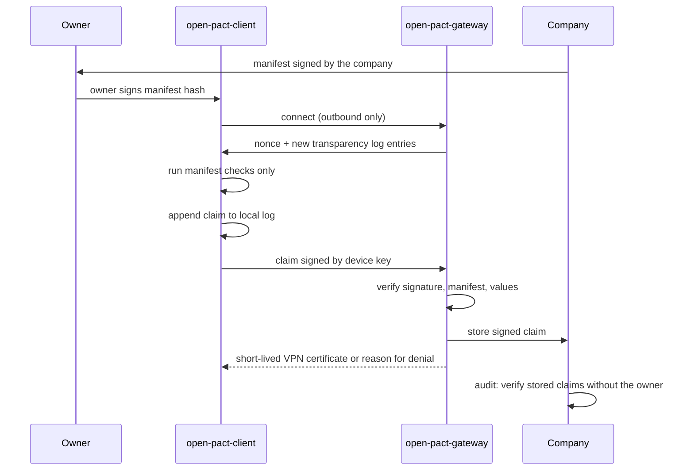

# open-pact: verifiable security on personally owned devices without blanket monitoring

Working draft, version 0.2, 25 September 2026. This is a technical proposal, not legal advice. Items marked "to verify" need confirmation by a lawyer, a DPO or a test on real systems.

## Summary

A company that works for banks and other regulated clients has to show that the laptops touching client data are encrypted, patched and locked. When those laptops belong to contractors, the usual answer is to install an MDM, a SIEM agent and a VPN client on them. Those tools can do far more than the policy says they do, and the device owner has no way to check what is actually switched on.

open-pact replaces "trust our configuration" with a signed, verifiable exchange. The company publishes a manifest that lists every check, its legal or contractual source and the exact values it may return. The owner signs that manifest. A small open-source client on the device runs only those checks and sends a signed claim such as `disk_encryption = full` when the device connects. Nothing else leaves the device, and the server has no way to run anything on it.

**For IT.** You deploy one container (`open-pact-gateway`). It verifies claims and issues short-lived VPN client certificates to compliant devices, so the VPN gateway needs no plugin, only trust in one CA. The first manifest covers the compliance baseline you already enforce (disk encryption, Secure Boot, OS patch age, supported OS, screen lock, password, firewall, antimalware) and adds a theft baseline: a user secret before disk unlock, encryption actually active on every writable disk, authentication on wake and no automatic login. `work_env` reports whether work happens on the host, in a work account or folder, in a VM or remotely. You get an automatic allow or deny at every connection and a signed record of each decision.

**For management and legal.** DORA and the Czech implementation of NIS2 require security measures and contractual assurance from suppliers. They do not name a product and do not require monitoring of subcontractors' own devices. The DORA risk management RTS, which binds the bank and reaches suppliers by contract, asks for remote management and wipe of the financial entity's data, controls that cannot be bypassed without authorisation, and denial of access to non-compliant endpoints. open-pact implements the denial of access directly. It addresses the bypass requirement by gating and detection rather than prevention (section 5), It does not implement remote wipe of the entity's data (Art. 11(2)(f)(i)); no solution without full-device wipe can do that on an offline stolen laptop, and Intune's Retire and Wipe also run only when the device next checks in. The bank must either accept that gap for approved data classes or require a remote work profile for projects that need it (section 4.6). Every check carries its source, the manifest supplies the data list, purpose, retention and recipients for the GDPR Article 13 notice, and signed claims let the company prove compliance to a regulator even if a contractor is unreachable.

**For contractors.** The client has no check that reads files, lists applications or logs activity, it accepts no commands, and its output format can only carry the enumerated values listed in the manifest. You can read every line of its code, see every claim you have sent, and stop it at any time. The only consequence of stopping is losing access. The scope cannot grow without your signature, and it cannot even shrink without you being told.

## 1. The problem

A software supplier for regulated clients asks its contractors to run an MDM, a SIEM agent and a VPN client on their own laptops. The goal is legitimate. The supplier must show its clients and supervisors that client data does not end up on an unencrypted, unpatched disk.

The difficulty is the method. Common tools (Intune, Wazuh, osquery, EDR) can do far more than any policy says they use. Wazuh can send diffs of file contents, and its central configuration takes precedence over local settings. Intune can run shell scripts as root on enrolled Macs; on Windows, script deployment depends on how the device is joined. A policy may say "the agent does not see your files", but the technical truth is "the feature that would see them is currently switched off". The owner cannot check this, and the setting can change on the server side.

Three patterns make this worse:

- Consent is tied to the "current" internal policy, a document one party can change on its own.
- A change counts as accepted if the contractor does not object within a deadline.
- Internal documentation changes and can contradict itself, for example on whether a personal device may be remotely wiped.

Nobody has to act in bad faith for this to go wrong. What is missing is a mechanism that binds both sides to the same precise, machine-checkable scope. open-pact proposes one.

## 2. Where the requirements come from

Not every requirement in a contract is a requirement of law. Every check in an open-pact manifest must name one of these sources:

| Source | Example |
|---|---|
| `law` | GDPR Art. 5(1)(c) data minimisation, Art. 25 data protection by design |
| `customer_contract` | A bank must put security and audit clauses into contracts with ICT providers (DORA Art. 30) and those flow down to subcontractors |
| `standard` | ISO/IEC 27001:2022 Annex A. Certification is voluntary; the standard is not law |
| `company_policy` | An internal decision of the company |

Scope rule: open-pact includes a check only if law or a demonstrable client contract requires it. Nothing more. The example first manifest (Appendix A) also carries three checks from the company's existing security baseline (`os_supported`, `password_set`, `firewall`), tagged `standard` or `company_policy`. They are there because the owner accepts them when signing, and the tag keeps that visible.

**DORA** binds only financial entities (Art. 2(2)). An ICT provider is bound through the contract under Art. 30. The ICT risk management RTS, Delegated Regulation (EU) 2024/1774, expects private endpoint devices to be used. For them it requires a solution to remotely manage devices and remotely wipe *the financial entity's data* (Art. 11(2)(f)(i)), security mechanisms that staff or ICT providers cannot modify, remove or bypass without authorisation (Art. 11(2)(f)(ii)), and network access controls that refuse endpoints not meeting the entity's requirements (Art. 13(d)). It names no product and does not require monitoring of subcontractors' devices. The subcontracting RTS, Delegated Regulation (EU) 2025/532, requires the provider to monitor subcontracted *services* and to pass on security standards by contract.

**Czech Act No. 264/2025 Coll.** (NIS2 transposition) handles suppliers by contract (§ 13(5)). Decrees 409/2025 and 410/2025 require measures also for assets the obliged entity does not administer, without naming a tool. Strict logging (logins and logouts, retention of at least 18 months, Decree 409 § 22) applies only in the higher regime and only to assets the entity puts in scope. In the lower regime the entity sets retention itself (Decree 410 § 9(3)). If a company shows that Decree 409 applies to contractor devices, open-pact can add an optional module that records logins to the work account only, keeps the log on the device and hands it over during an incident.

**GDPR** applies throughout. Under EDPB Guidelines 2/2019 and 1/2024, processing is not "necessary" if a realistic, less intrusive alternative exists. WP29 Opinion 2/2017, which also covers freelance relationships, asks that private and business use of a personal device be kept apart. A tool that proves compliance with a few enumerated values is such an alternative. Whether a given deployment is lawful needs its own assessment, including a DPIA (GDPR Art. 35, to verify).

**A supplier is not an employee.** Many BYOD policies are written for employees and then extended to contractors. For suppliers the normal model is different: the supplier runs its own security measures and the client verifies them by audit, certification or report. DORA assumes this (Art. 30(3)(c) and (e), RTS 2024/1773 Art. 6), and so do the Czech decrees (409 Annex 5, 410 Annex 2) and ISO 27001 (controls 5.19 to 5.22). open-pact is the technical form of that model. A contractor with several clients also cannot let one client's agent read files that belong to another client.

## 3. Threat model

| # | Threat | MDM + SIEM helps? | open-pact helps? |
|---|---|---|---|
| T1 | Lost or stolen laptop | Yes (encryption, lock) | Yes, verifies encryption and lock before access |
| T2 | Careless owner: firewall off, old OS, no password | Yes | Yes, the main purpose |
| T3 | Malware on the device | Partly, if someone reads alerts | Partly, see below |
| T4 | Malicious owner with root | No, root disables or feeds the agent | No, same |
| T5 | Compromised company admin console | No. MDM creates this risk: remote script execution gives an attacker SYSTEM on every laptop at once | Yes, the protocol has no remote execution |
| T6 | Misuse of data by an admin (curiosity, client pressure) | No, only policy limits it | Yes, data that never leaves cannot be misused |

**T4 is not solved on the device by anyone.** Root defeats any agent. Against a malicious insider the defences are server side: access rights, repository logs, data loss prevention where data leaves company systems.

**T5 is why less is safer.** Every capability given to a central console is also given to whoever steals it. "The device only answers fixed questions" has a smaller attack surface than "the server may run anything on the device".

**T3 is the hard one.** Detecting an active attack needs telemetry such as processes and network connections, which is sensitive. Most attacks on company systems pass through the VPN and can be seen at the network edge. On the device, open-pact offers forensics on request only (section 4.6) and the optional module from section 2.

## 4. Protocol

The company runs the server (`open-pact-gateway`); the client (`open-pact-client`) runs on the owner's device.



### 4.1 Manifest

The manifest is a versioned TOML document. For every check it states what is verified, why, by which built-in code, what exactly may leave the device, and what value is required on each operating system. A full example is in Appendix A.

```toml
[[control]]
id = "disk_encryption"
source = "customer_contract"
source_ref = "Client contract, security annex, 4.2"
rationale = "A lost laptop must not expose client data."
check = "builtin:disk_encryption@1"     # built-in checks only, no shell
output = ["full", "partial", "none", "unknown"]
required = { macos = "full", windows = "full", linux = "full" }
grace = "0d"
```

- **Outputs are enumerations, not text.** `disk_encryption` discloses at most two bits. No disk names, partition lists or serial numbers.
- **`check` refers only to checks compiled into the client.** There is no `builtin:shell` and no `builtin:osquery`. A new check means a new client release, public review and a new manifest. This is the technical answer to "how do you guarantee the configuration will not change after we agree".
- **Every check names its source**, so the owner and the auditor can see what is law and what is policy.
- **Requirements are set per operating system.** A check can require different values on macOS, Windows and Linux, or be omitted on one of them.
- **`grace`** sets how long a failed check keeps access before denial. `0d` denies immediately.
- **`unknown_grace`** applies when a check cannot determine the state. It is separate from `grace` and never zero, so a bug in a check after an OS update does not lock every user of that OS out at once, even for checks that deny a real failure immediately.

### 4.2 Consent bound to a hash

1. The company signs the manifest. By signing, it commits to asking for nothing else.
2. The owner reads the manifest (the client shows a human-readable diff against the previous version) and signs its SHA-256 hash.
3. The client runs checks only from a manifest the owner signed, or from a machine-verifiable narrowing of it. Any other manifest does nothing.

A change of scope means a new version, a new hash and a new owner signature. Silent consent after a deadline is technically impossible. The one exception is narrowing. The client accepts the old signature only if all of these hold:

- every check in the new manifest existed in the old one, and its set of outputs is a subset of the old set;
- `claim_retention` is equal or shorter;
- `data_controller`, `claim_recipients` and `disclosed_metadata` are unchanged or smaller;
- no `required` value is stricter and no `grace` is shorter;
- `claim_max_age` is not shorter;
- the minimum `trust_level` is not higher.

Even a narrowing is never silent. The client shows it to the owner as a diff before first use and records it in the local log.

There is no emergency exception. If a zero-day makes the company want patches within two days instead of fourteen, the owner signs the stricter manifest, from a phone if needed. Until then the gateway issues no new certificate. That is a loss of access, nothing more.

**Client updates.** The client never updates itself. The company may set a minimum client version without the owner's signature. The minimum version is not part of the manifest (that would change its hash); it is a company-signed entry in the transparency log. This is the only exception to the rule on stricter changes, and it has three conditions: the version is recorded in the transparency log and reproducible from source, the owner installs it and sees what changed, and every version still runs only checks from the signed manifest. New checks therefore always need a new manifest and a new owner signature. An outdated client is refused access.

### 4.3 Claim

When the device connects, the client produces a claim and signs it with the device key:

```json
{
  "manifest": "sha256:9f2c...",
  "device": "pseudonym:4b1e...",
  "nonce": "from the gateway, single use",
  "time": "2026-11-03T08:12:44Z",
  "client": "open-pact-client 0.4.1",
  "os": "macos",
  "trust_level": "L1",
  "virtualized": "no",
  "results": {
    "disk_encryption": "full",
    "secure_boot": "on",
    "os_patch_age": "le_14d",
    "firewall": "on"
  },
  "log_checkpoint": { "size": 42, "root": "m1Rw..." }
}
```

- **Format.** JSON with canonical serialisation (RFC 8785), signed as JWS with ES256 (P-256). P-256 is the curve the Secure Enclave supports and TPM 2.0 supports widely, so the device key can stay in hardware. CBOR/COSE may follow when hardware attestation arrives.
- **Device key.** Generated in TPM 2.0 or the Secure Enclave (vTPM inside a VM) and not exportable. A device without hardware key storage is refused. `trust_level` states what backs the claim (section 5) and the manifest sets the minimum.
- **One key per company.** At `join` the client creates a separate device key and a separate VPN certificate key for each company. A public key is itself a stable identifier, so sharing one key would let companies link the device. The pseudonym is the hash of that company-specific key.
- **Everything that leaves.** Besides `results`, every claim carries the mandatory metadata, and the manifest must list each item in `disclosed_metadata` or it does not parse: `manifest_hash`, `device_pseudonym`, `device_key` (the public key, with the signature), `nonce`, `time`, `client_version` (exactly `open-pact-client <major>.<minor>.<patch>`, so the field carries no free text), `os`, `trust_level` and `vpn_certificate_request` (the SHA-256 of a certificate request for the VPN key; the request itself travels beside the claim, carries only the VPN public key, with an empty subject and no extensions, and the gateway does not store it). Two items are optional, and the client sends them only if the manifest lists them: `virtualized` and `log_checkpoint` (size and root of the last transparency log checkpoint the client verified). The gateway denies a claim with an optional item the manifest does not list and does not store it. The gateway also sees the source IP address, as any server does. At enrolment the device sends its public keys; incident reports leave only when the owner starts them. With L2 attestation, boot measurements will be added, which reveal bootloader and kernel versions, and must then be listed in `disclosed_metadata`.
- **Optional `in_eea`.** If a client contract requires it, the gateway derives yes or no from the source IP it already sees and stores only that result, not the IP. The client sends nothing new. It is off by default and must be listed in `disclosed_metadata`.
- **Metadata.** Time, pseudonym and hashes form a record of when a device connected. That is personal data, so the manifest lists it in `disclosed_metadata` and `claim_retention` applies. The company already holds the same record in its VPN logs; open-pact does not add to it.
- **Pull only.** The client does not run as a service and opens no port. The VPN connect script or the owner starts it, and its only connection is outbound to the gateway. When the owner is not connected to the company, the client does nothing.
- **Local log.** Every claim sent is appended to a log on the device, byte for byte (`open-pact-client log`). The owner always knows exactly what was sent. The log is backed up by encrypted sync to a relay (which may be the gateway) and restored on a new device from the owner's secret, which can be written down as a mnemonic phrase. The relay sees only ciphertext. The model follows the local-first library Evolu; that library is TypeScript, so the Rust client reimplements the model.
- **Virtual machines.** If work happens in a VM, the main claim comes from the VM, where the company data is. The host adds only disk encryption and screen lock. The claim carries `virtualized: yes`.
- **Several devices.** Each device has its own keys (one per company), claims and certificate, all linked to the owner's personal key. A non-compliant device loses access on its own.

### 4.4 Gateway instead of continuous monitoring

The company does not need to know what happens on the laptop at 22:00 on a Saturday. It needs to know that the device meets the requirements when it reaches company systems.

- At connection, the gateway sends a nonce, receives the claim, and checks the signature, the manifest hash, the client version and the values.
- If something fails, it refuses and says why ("disk_encryption = none, full required"). `open-pact-client status` shows the owner the failed checks, the remaining grace period and exact fix instructions for the owner's OS. The client never changes the system itself.
- **VPN integration uses short-lived certificates.** The gateway is a small certificate authority. A compliant device gets a VPN client certificate valid for, say, 24 hours. The certificate key is generated on the device, in hardware, and never leaves it. VPN gateways such as FortiGate already verify client certificates, so they need no plugin, only trust in this CA. A non-compliant device gets no new certificate and cannot connect once the old one expires. Whether the VPN client (for example FortiClient) can use a non-exportable key held in the TPM or Secure Enclave is to verify on each platform. RADIUS or Entra ID Conditional Access are alternatives, also to verify.
- **Gateway outage.** The last valid certificate stays valid until `claim_max_age`. A new claim is sent once the gateway is back. An outage does not stop everyone at once.

**What the company stores.** The gateway decides automatically; no person reviews claims day to day. The company stores the signed claims themselves. They are readable, but contain only the enumerated values and the listed metadata. Each claim is signed by the device key, so it verifies on its own. The company can show a regulator "device X signed `disk_encryption = full` on 3 November at 08:12" even if the owner's laptop has since died. The company cannot forge a claim, because it does not hold the device key. Privacy here rests on minimisation, not on encryption: nothing but enumerated values is ever sent.

On disk, claims are encrypted with a key per period (for example per month). Deleting a period deletes its key, which makes the claims unreadable in every backup too (section 4.8).

We considered sealed copies, 2-of-3 key sharing with a third party, and time-lock encryption (drand). None of them can give the company access without the owner while also preventing an attacker holding the company's data from reading it, and time-locks need an external clock. For a handful of enumerated values the added complexity is not worth it.

**Admin access.** The gateway has no claim browser. An admin sees a summary (how many devices comply) and approves new devices. Details for one device are shown only during an audit or incident, and each view is recorded in the transparency log. Limit: someone with root on the gateway server can bypass the interface. That is covered by the company's own access controls.

**Deployment.** One Rust binary in a container with PostgreSQL (the company's existing instance or one alongside), HTTPS, on the company's infrastructure. Claims are encrypted by the gateway per period before they reach the database, so crypto-shredding does not depend on database internals or backups. The company manages its own keys (manifest signing key and gateway CA). open-pact documents the risks and recommends hardware key storage, but does not dictate how.

### 4.5 Transparency log

The log is a list of events about the rules. Nothing can be removed from it or quietly rewritten. It holds only hashes of events, never device data:

- every manifest version (with the owner's signature when scope grows);
- every approved client release and minimum version;
- every agreed deletion (signed by both sides);
- every incident report (signed by the owner, timestamped by the gateway);
- every admin view of a single device's details.

The log is copied to every contractor, so entries about one person (incidents, admin views, deletions) carry only a commitment: a salted hash that reveals nothing to colleagues. The affected owner is notified and receives the opening, so they can prove the entry is about them.

The log is a Merkle tree, hashed as in Certificate Transparency (RFC 9162). Changing or removing any past entry changes the root. The gateway keeps the log and signs checkpoints. A checkpoint states the log's name, the number of entries and the root, in the C2SP checkpoint and signed-note formats. On every connection the client fetches the latest checkpoint and a consistency proof. The proof is a few hashes that show that the new tree contains the tree the client verified before, unchanged. The client keeps the new checkpoint and puts its size and root into each claim, so every signed claim also states which history of the rules the device saw. While connected, the client holds an outbound connection and receives new checkpoints immediately. It opens no port. If a proof fails, the client raises an alarm.

The gateway could still show different histories to different people. Witnesses close this gap. A witness is an independent party, for example the bank's auditor, that cosigns a checkpoint only if it extends the last checkpoint the witness cosigned (C2SP tlog-witness). The gateway serves the cosignatures with the checkpoint. Two checkpoints of the same size with different roots, both signed by the gateway, are signed proof of tampering. Contractors can also compare checkpoints among themselves (`open-pact-client log head`). An owner can show one entry about them to a third party with an inclusion proof against a cosigned checkpoint (`open-pact-client log prove`), without handing over the whole log. Unlike a wiki page whose history can be deleted, every change here shows.

### 4.6 Enrolment, device changes, incidents and leaving

- **Enrolment.** IT sends an invitation with a one-time code, the gateway address and the fingerprint of the company key. `open-pact-client join <code>` creates the device key in hardware, shows the manifest, and the owner signs; IT confirms. The fingerprint protects against a fake gateway.
- **Owner's personal key.** It signs manifests, approves new devices, reports incidents and requests deletion. It is derived from a 24-word mnemonic phrase (optionally with a passphrase), which also derives the key for the encrypted log backup (SLIP-10, P-256). The phrase is the recovery path and belongs on paper; for daily signing the key lives in the macOS Keychain or on a YubiKey (PIV import). The Secure Enclave cannot import keys, so it holds only device keys. Device keys are never derived from the phrase: a key that can be recreated anywhere cannot prove which device signed. A leaked phrase is handled like a lost device: new phrase, new personal key, company approves the change. The client warns if the key exists only on the same laptop, because after a theft the owner could not report the incident from another device.
- **New or lost device.** The new device creates a new key, the owner signs it with the personal key, and the company approves it on the gateway. The owner or the company revokes the old key, immediately after a theft.
- **Incident.** Reporting stays a human duty; the client makes it easier. `open-pact-client incident` revokes the device's key and certificate, sends a report with a gateway timestamp as proof it was reported in time, and shows the full report before sending. After a theft it works from another device with the owner's personal key. Forensic analysis of a personal device happens only with the owner's consent, in an agreed scope, and in the owner's presence.
- **No wipe, and an honest gap.** The protocol cannot wipe anything. After a theft it revokes access at every company service (device key, VPN certificate, tokens, sessions). Local data is protected by the theft baseline in Appendix A: full-disk encryption active on every writable disk, a user secret before unlock (TPM-only unlock is not enough), immediate authentication on wake, and shutdown or validated hibernation for transport. At `leave` the owner deletes company data and signs a statement that it is done.
  - This does **not** implement RTS 2024/1774 Art. 11(2)(f)(i), remote wipe of the entity's data. On a laptop that the thief keeps offline, no solution short of full-device wipe or keeping data off the laptop can guarantee selective erasure. Intune does not either: Retire and Wipe run only when the device next checks in, and Retire on macOS removes profiles and certificates, not files.
  - open-pact therefore defines two work profiles. **Local development:** only data classes the bank approves for BYOD storage, with the erasure gap accepted explicitly by the bank. **Remote:** production data and sensitive projects stay in a company-controlled remote environment (`work_env = remote`).
  - Rejected alternatives: an encrypted vault unlocked by a gateway-held key (developer data spreads outside it: Docker and OrbStack storage, IDE and package caches), and a local timer that destroys keys after N days offline (a powered-off laptop never runs it, an unlocked thief copies data first, and a gateway outage would trigger it on honest devices). Full-device Wipe deletes personal data and gives whoever controls the console the power to erase every contractor's laptop at once.
  - **Work account or work folder.** A dedicated OS work account keeps most caches, IDE, browser and chat data in one home and is the preferred way to separate work. An encrypted work folder (for example `~/bp`, an APFS encrypted volume, LUKS container or BitLocker VHD) is optional. Both make owner-assisted cleanup easier; neither proves that every work artifact is inside. `work_env` and `workspace_volume` report the mode and whether the storage has its own encryption, without scanning files.
- **Leaving.** `open-pact-client leave` removes keys, certificates and the client from the device and produces a signed record. Claims at the company stay until `claim_retention` ends, for audits of the collaboration period, and are then deleted with a confirmation. Earlier deletion by agreement is possible.

### 4.7 Stopping

The owner can stop the client (`open-pact-client stop`) or uninstall it at any time. The only consequence: after `claim_max_age` the gateway gets no valid claim and refuses access. Stopping and forging are different events and the protocol tells them apart. A stopped client sends nothing; a forged claim is signed and traceable.

### 4.8 Agreed deletion

- **Automatic** when `claim_retention` ends.
- **On request.** Owner and company both sign a deletion request with a scope (device, period). The gateway deletes the data and issues a signed deletion confirmation. The event (hashes of request and confirmation, not the data) goes into the transparency log.
- **Backups.** Claims are encrypted per period on disk. Deleting the period key makes them unreadable in backups too.
- **Exception.** Deletion is postponed while an audit, an incident or a legal retention duty is running. The owner gets the reason and the expected date in writing.
- **Limit.** Cryptography cannot prove that the other side deleted everything. There is a signed confirmation and crypto-shredding.

### 4.9 Guarantees for the device owner

| Guarantee | How it is enforced |
|---|---|
| I know what I sent | Local log of every claim, byte for byte, with encrypted backup |
| The company does not watch continuously | No telemetry. The gateway decides automatically and stores only signed enumerated values |
| Admins do not look at individuals without cause | No claim browser, summary only. Single-device views during audit or incident, each recorded in the transparency log. Limit: root on the gateway server |
| The company can prove compliance without me | Claims are signed by the device key and verify on their own |
| Agreed deletion | Both signatures, signed confirmation, crypto-shredding of backups. Deletion at the other side cannot be proven cryptographically |
| I can stop it at any time | No service, no port, `open-pact-client stop`. The only consequence is loss of access |
| Scope does not change without my knowledge | The client runs only a signed manifest, shows and logs every narrowing, and never updates itself |
| Scope does not grow without my consent | Any expansion or tightening needs a new owner signature, with no emergency exception |
| The company cannot act on my device | No channel from server to device except a nonce and log entries |
| A compromised company does not endanger my device | Same. An attacker in the company console gets at most the stored claims |

The client itself must not become a new weakness. Checks that need administrator rights (for example BitLocker status) run in a small separate process; everything else runs with user rights. The device key stays in hardware. Releases are signed and reproducible.

## 5. Limits of trust

Cryptography proves who signed a claim and that nobody changed it. It does not prove that what a device says about itself is true when its owner controls it. open-pact states its trust levels openly:

| Level | What it proves | Can root fake it? |
|---|---|---|
| L0 | Signature: who sent the claim, unchanged in transit | Yes |
| L1 | Key in TPM or Secure Enclave: the claim came from this physical device | The key no, the content yes |
| L2 | Measured boot attestation (TPM quote): what booted, including Secure Boot and, on Windows, BitLocker state | No, short of a hardware attack |

A level is only worth what the gateway can verify. A Secure Enclave or TPM key protects against key theft, but a claim's `trust_level` is the client's own assertion until attestation binds it to the enrolled key and a fresh challenge. Until then the gateway counts every claim as L0, keeps the asserted level apart from the verified one, and denies a claim when the manifest's minimum is higher.

Runtime settings (screen lock, firewall, updates) cannot be proven cryptographically on a device its owner controls. The same holds for Intune and Wazuh. These checks are reported and the owner stays responsible for the real state of the device. A claim is evidence, not a transfer of responsibility. The project is open source and comes without warranty.

**Making a modified client harder to use and easier to catch.** On a device the owner controls, modifying a program cannot be prevented completely. It can be made so that a modified client cannot produce valid proof, or so that the change comes to light:

- **Signed, reproducible releases.** Every `open-pact-client` release is signed and recorded in the transparency log. Anyone can build it from source and get the same hash.
- **Allowed client hashes in the manifest.** The gateway refuses claims from other versions. On its own this is not enough, because a modified client can report someone else's hash. Hence the next points.
- **Linux: TPM and IMA.** The kernel measures the hash of every program into the TPM before running it. The client sends a TPM quote and the gateway sees which binary really ran. Root cannot hide a modified binary. This is the strongest option.
- **macOS: no Apple attestation without MDM.** App Attest is not available on Macs (Apple documents that `DCAppAttestService.isSupported` returns `false` on any Mac), and Managed Device Attestation requires MDM enrolment. The remaining protection is weaker: the device key lives in the Secure Enclave in a keychain access group bound to the publisher's code signature, so a re-signed, modified client cannot use it; the hardened runtime blocks code injection; and the claim reports whether System Integrity Protection is on, with SIP off lowering `trust_level`. Root with SIP disabled can still defeat this (to verify in the pilot).
- **Windows: weakest.** The TPM measures boot (Secure Boot, BitLocker) but not running applications. Boot state can be proven, the client version cannot.
- **Random live audit.** An auditor runs their own verified build on the device and compares its result with the last claim. A mismatch is proof of modification.

Other limits:

- **Built-in checks must be correct.** A bug in `builtin:disk_encryption` on a new macOS release gives a wrong result. The answer is public code, tests in CI on real macOS, Windows and Ubuntu for both states of every check (for example a VM with encryption on and off), tests on OS betas, and `unknown` rather than a guess.
- **No active attack detection (T3)** beyond the optional module. This is a deliberate choice.
- **No data loss prevention.** RTS 2024/1774 Art. 11(2)(i) asks for data loss prevention on endpoints as well. On a private machine that is not reasonable without deep monitoring. VDI or a remote development environment solves it by keeping the data off the laptop.

## 6. Rust for the code, Lean for the rules

The client runs on someone else's machine, partly with administrator rights. Hence Rust: memory safety, one static binary for Windows, macOS and Linux, no runtime, and good support for reproducible builds. The scope is small. A manifest parser, signature checks, a dozen checks and JSON output fit into a few thousand lines that can be read in full during review.

Writing the client itself in Lean is possible (Lean compiles to C and runs on all three platforms), but the parts that matter here would all be calls into C: TPM and Secure Enclave, BitLocker, FileVault and LUKS status, TLS. Community Lean libraries for HTTP wrap libcurl, and we found no audited Lean implementation of P-256 or JWS.

Lean is used for what it does best: an executable model of the protocol rules, with proofs. The model covers:

1. **Narrowing.** A manifest change passes without the owner's signature only if it is a true narrowing (section 4.2). No new check, wider output, stricter value, shorter grace or longer retention gets through unsigned.
2. **Disclosure contract.** A claim contains only fields the manifest lists, and every value belongs to its declared enumeration, so `results` carries at most Σ log₂|enumeration| bits. The metadata in `disclosed_metadata` is counted separately.
3. **Transparency log.** A verified consistency proof means that the old tree is an unchanged prefix of the new one, and a verified inclusion proof means that the entry is in the tree with that root.
4. **Grace periods.** `unknown` never denies access immediately, and `grace` behaves as the manifest says.

The OS checks themselves cannot be proven; they are tested on real systems (section 5).

The Rust implementation is tied to the model by differential random testing, the method AWS uses for the Cedar policy language: millions of generated manifests, changes and claims go through both the Lean model and the Rust code in CI, and any disagreement is a bug in Rust. The owner then does not have to trust the implementers: the rules consent rests on are proven, and the code is continuously checked against them.

## 7. Common objections

| Objection | open-pact answer |
|---|---|
| Can IT see my files? | With MDM the answer is "no, because we have not switched it on". With open-pact it is "no, because the client has no such check and its output is an enumeration". You can verify that in the code. |
| My clients do not expect an intermediary to see logs or run scripts with system rights. | open-pact has no remote execution and no logs. Your client can read the manifest and see exactly what leaves. Each company has its own manifest and device pseudonym. |
| The documentation lives on a wiki whose history can be deleted. | The transparency log (section 4.5). The wiki can keep explaining; the signed manifest is what binds. |
| What data is collected, how long is it kept, who can access it (GDPR Art. 13)? | The manifest lists the data (enumerations and `disclosed_metadata`), purpose (`rationale`), source, retention, recipients and controller. The company's Art. 13 notice adds the legal basis and data subject rights. |
| Which agents run, with which rights? What does "company connection" mean? Can admins run commands? | One open-source client, running only when connecting. No commands from the server. "Company connection" is exactly the moment the gateway asks for a claim. |
| A SIEM agent can send diffs and run commands. How do you guarantee the configuration will not change after we agree? | Checks are compiled in, not configured from the server. Expanding them needs a new release, a new manifest and a new owner signature. |
| I develop on Linux. | Ubuntu and Fedora with GNOME and KDE are supported from the first version. Other desktops return `unknown` for screen lock (with grace). Encryption (LUKS), firewall (ufw, firewalld, nftables) and updates work everywhere. |
| Can I work in a dedicated VM or on a company device? | open-pact runs inside the VM and adds disk encryption and screen lock from the host. A company-issued device removes the question entirely. |
| How does leaving work? | Section 4.6: keys and client removed at once, claims deleted after retention with confirmation. |
| Does open-pact track where I work from? | No. Location is not device state. The company already sees the country from the VPN connection's IP address. |

## 8. What exists today and why it is not enough

- **Remote development environments** (VDI, Windows 365, Azure Virtual Desktop, dev containers on company infrastructure). Code and data stay with the company; the laptop is a terminal. For regulated projects this is often the cleanest answer, with no need for open-pact. The costs are latency, price and developer comfort.
- **Company-issued device or managed VM.** Separates private life from work completely.
- **Intune MAM without enrolment.** Protects data in supported apps (Office, Edge), not in an IDE, a terminal or Docker. Not enough for developers.
- **osquery / Fleet.** Open source, but essentially SQL over the whole system, sent by the server. Same problem as Wazuh: the capability is unlimited and only configuration limits it. Usable as a library for some checks, not as a trust model.
- **Kolide (now part of 1Password) and "Honest Security"** (honest.security). Closest in spirit: the user sees what is checked and fixes it. It is a commercial product with server-configured queries.

open-pact adds three things we have not found combined in any existing tool: compiled-in checks instead of configurable ones, consent bound to a manifest hash, and output limited to enumerations with a stated source.

## 9. Roadmap

The repository holds both parts: the client and the gateway. A company deploys the gateway; it does not write code.

1. **Now.** This paper.
2. **Proof of concept** (after agreement with the company). One check, `disk_encryption`, on macOS (FileVault via `fdesetup status`) and Linux (LUKS). Manifest signed by both sides, claim with nonce, local log, `open-pact-client stop`, and a gateway that stores signed claims. A software device key is allowed for development only.
3. **Pilot.** The first manifest (Appendix A) on macOS, Windows and Linux. VPN access through short-lived certificates. Transparency log in the gateway. Device key in TPM 2.0 or Secure Enclave, required. CLI only.
4. **Hardware proof (planned).** Measured boot attestation through the TPM (L2). On Windows, BitLocker and Secure Boot proven cryptographically rather than reported. On Linux, the same plus proof of the running client through IMA. On macOS, Apple offers no attestation without MDM; the client relies on a Secure Enclave key bound to its code signature and a SIP status check.
5. **open-pact Foundation.** A neutral legal entity that maintains the public project (releases, review of new checks). It holds no keys and no data.
6. **Lean model and differential testing** from the proof of concept onward: narrowing rule, disclosure contract, log proofs and grace periods, checked against the Rust code in CI.
7. **Optional.** A tray icon, the Decree 409 logging module.

Out of scope on purpose: remote execution, log collection, wiping personal devices, location, and any check whose output is not a small enumeration. Work rules such as daily pushes to a repository, approved AI tools or approved storage are contractual duties checked on the server or by audit, not device state.

## Appendix A. Example first manifest

```toml
manifest_version = 1
issuer = "company.example"
valid_from = "2026-11-01"
claim_max_age = "24h"
claim_retention = "12mo"
claim_recipients = ["Company IT security", "auditor on request"]
disclosed_metadata = ["manifest_hash", "device_pseudonym", "device_key", "nonce", "time", "client_version", "os", "trust_level", "vpn_certificate_request", "virtualized", "log_checkpoint"]
data_controller = "Company Ltd., dpo@company.example"
min_trust_level = "L1"
unknown_grace = "7d"                 # default for all checks, never zero
# The minimum client version is set by a company-signed entry in the transparency log, not here.

[[control]]
id = "disk_encryption"
source = "customer_contract"
check = "builtin:disk_encryption@1"
output = ["full", "partial", "none", "unknown"]
required = { macos = "full", windows = "full", linux = "full" }
grace = "0d"

[[control]]
id = "secure_boot"
source = "customer_contract"
check = "builtin:secure_boot@1"
output = ["on", "off", "unknown"]
required = { macos = "on", windows = "on", linux = "on" }
grace = "3d"

[[control]]
id = "os_patch_age"
source = "customer_contract"
source_ref = "Flow-down of RTS 2024/1774 Art. 10"
check = "builtin:os_patch_age@1"
output = ["le_14d", "le_30d", "gt_30d", "unknown"]
required = { macos = "le_14d", windows = "le_14d", linux = "le_14d" }
grace = "3d"

[[control]]
id = "os_supported"
source = "standard"
check = "builtin:os_supported@1"   # Windows 10: yes only with ESU or LTSC; Home/Pro support ended 14 Oct 2025
output = ["yes", "no"]
required = { macos = "yes", windows = "yes", linux = "yes" }
grace = "14d"

[[control]]
id = "screen_lock"
source = "customer_contract"
source_ref = "Flow-down of RTS 2024/1774 Art. 13(l)"
check = "builtin:screen_lock@1"
output = ["le_5min", "le_15min", "gt_15min", "off", "unknown"]
required = { macos = "le_5min", windows = "le_5min", linux = "le_5min" }
grace = "1d"

[[control]]
id = "password_set"
source = "standard"
check = "builtin:password_set@1"
output = ["yes", "no"]
required = { macos = "yes", windows = "yes", linux = "yes" }
grace = "0d"

[[control]]
id = "firewall"
source = "company_policy"
check = "builtin:firewall@1"
output = ["on", "off", "unknown"]
required = { macos = "on", windows = "on", linux = "on" }
grace = "1d"

[[control]]
id = "antimalware_active"
source = "law"
source_ref = "Decree 410/2025 § 9(1)(b), binds the company if registered and the device is in scope"
check = "builtin:antimalware_active@1"   # Windows: Security Center; macOS: XProtect + Gatekeeper; Linux: ClamAV or similar
output = ["yes", "no", "unknown"]
required = { macos = "yes", windows = "yes" }   # omitted on Linux
grace = "3d"

[[control]]
id = "work_env"
source = "customer_contract"
source_ref = "Work profile agreed with the bank"
check = "builtin:work_env@2"   # reports the owner's registered mode, manages nothing
output = ["host", "workfolder", "workaccount", "vm", "remote", "unknown"]
required = {}                   # a sensitive project may require remote
grace = "0d"

[[control]]
id = "workspace_volume"         # optional, only when a work folder or account is registered
source = "company_policy"
check = "builtin:workspace_volume@1"   # OS mount and encryption metadata only, no file scanning
output = ["dedicated_encrypted", "shared_host_encryption", "unencrypted", "missing", "unknown"]
required = {}
grace = "1d"

# Theft baseline

[[control]]
id = "preboot_auth"
source = "customer_contract"
source_ref = "Theft baseline: user secret before disk unlock"
check = "builtin:preboot_auth@1"   # BitLocker TPM+PIN, FileVault, LUKS passphrase or TPM+PIN
output = ["user_secret", "hardware_only", "other", "unknown"]
required = { macos = "user_secret", windows = "user_secret", linux = "user_secret" }
grace = "0d"

[[control]]
id = "disk_protection"
source = "customer_contract"
check = "builtin:disk_protection@1"   # encryption active, not suspended or pending
output = ["active", "suspended", "pending", "unknown"]
required = { macos = "active", windows = "active", linux = "active" }
grace = "0d"

[[control]]
id = "encryption_coverage"
source = "customer_contract"
check = "builtin:encryption_coverage@1"   # all writable local volumes, including swap
output = ["all_writable_local", "boot_only", "partial", "unknown"]
required = { macos = "all_writable_local", windows = "all_writable_local", linux = "all_writable_local" }
grace = "1d"

[[control]]
id = "wake_auth"
source = "customer_contract"
check = "builtin:wake_auth@1"
output = ["immediate", "delayed", "off", "unknown"]
required = { macos = "immediate", windows = "immediate", linux = "immediate" }
grace = "1d"

[[control]]
id = "auto_login"
source = "customer_contract"
check = "builtin:auto_login@1"
output = ["off", "on", "unknown"]
required = { macos = "off", windows = "off", linux = "off" }
grace = "0d"
```

## Sources

- Regulation (EU) 2022/2554 (DORA), Art. 2, 28, 30. https://eur-lex.europa.eu/eli/reg/2022/2554/oj
- Delegated Regulation (EU) 2024/1774 (RTS on ICT risk management), Art. 6, 7, 10–13, 21. https://eur-lex.europa.eu/eli/reg_del/2024/1774/oj
- Delegated Regulation (EU) 2024/1773 (RTS on contractual policy), Art. 6. https://eur-lex.europa.eu/eli/reg_del/2024/1773/oj
- Delegated Regulation (EU) 2025/532 (RTS on subcontracting), Art. 3, 4. https://eur-lex.europa.eu/eli/reg_del/2025/532/oj
- Directive (EU) 2022/2555 (NIS2), Art. 21.
- Czech Act No. 264/2025 Coll. on cybersecurity; Decrees 408/2025, 409/2025, 410/2025 Coll. https://www.zakonyprolidi.cz/cs/2025-264
- Regulation (EU) 2016/679 (GDPR), Art. 5, 6, 13, 25, 35. https://eur-lex.europa.eu/eli/reg/2016/679/oj
- EDPB Guidelines 2/2019 on Art. 6(1)(b); EDPB Guidelines 1/2024 on legitimate interest (public consultation version); WP29 Opinion 2/2017 on data processing at work (WP249), section 5.4.2.
- ISO/IEC 27001:2022 Annex A; ISO/IEC 27002:2022 guidance (from public summaries).
- Wazuh 4.x documentation: centralized configuration, FIM `report_changes`, `local_internal_options.conf`. https://documentation.wazuh.com
- Microsoft Intune Retire and Wipe actions. https://learn.microsoft.com/en-us/intune/device-management/actions/retire ; https://learn.microsoft.com/en-us/intune/device-management/actions/wipe
- BitLocker countermeasures (TPM-only vs TPM+PIN). https://learn.microsoft.com/en-us/windows/security/operating-system-security/data-protection/bitlocker/countermeasures
- NIST SP 800-46 Rev. 2 (telework and BYOD). https://csrc.nist.gov/pubs/sp/800/46/r2/final
- RFC 9162, Certificate Transparency Version 2.0, section 2.1 (Merkle tree, inclusion and consistency proofs). https://www.rfc-editor.org/rfc/rfc9162.html
- C2SP tlog-checkpoint, signed-note, tlog-cosignature and tlog-witness. https://c2sp.org/tlog-checkpoint ; https://c2sp.org/signed-note ; https://c2sp.org/tlog-cosignature ; https://c2sp.org/tlog-witness
- Evolu, local-first library. https://www.evolu.dev
- Kolide, Honest Security. https://honest.security
- AWS Cedar: verification-guided development with a Lean model and differential testing against Rust. https://lean-lang.org/use-cases/cedar/ ; https://arxiv.org/pdf/2407.01688
